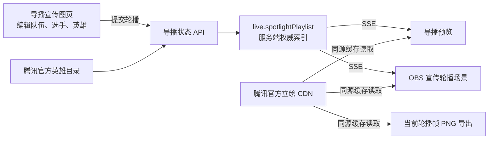

# PKC 选手宣传轮播与首发名单海报设计

日期：2026-10-21

## 目标

在现有导播宣传图流程中增加一套用于直播的选手宣传轮播，并把赛前宣传图改为首发名单版式。

- 直播画面为 1920×1080 横版。标题固定显示“2026 PKC 淘汰赛 · 16进8”。当前轮次左右各显示一名选手、手填的代表英雄及该英雄的腾讯官方立绘；两队名称显示在各自选手信息下方。
- 五个位置（上单、打野、中路、发育路、游走）按同一索引轮播，两队同位置同时展示。导播可自动播放、暂停、手动切换和设置间隔。
- 导播宣传图页可预览和导出当前轮播位置的 PNG。
- 赛前名单海报采用参考图二的金色赛事视觉和首发阵容层级，沿用此前确认的 16:9 横版格式。
- 队名和选手姓名继续从当前赛事队伍库预填，手动输入仍可覆盖；代表英雄由导播填写。

## 当前结构

- `director/promo.html` 与 `assets/pkc-promo.js` 提供队伍选择、五人名单编辑、16:9 Canvas 预览和 PNG 下载。
- `bp-core/src/scenes.js` 注册导播场景；`bp-core/src/store.js` 保存预览、在播和现场轮播状态。
- `director/routes.mjs` 提供场景状态 API 和 SSE；`director/obs.html` 根据当前场景绘制 1920×1080 画面。
- 赛后数据图已经有服务端推进的轮播实现，可作为同一索引驱动导播预览和 OBS 的模式参考。

## 方案

新增独立的“选手宣传轮播”场景，复用当前宣传图页作为选手与代表英雄的编辑入口。提交时将两队队名、五个位置的选手姓名和英雄名，以及轮播间隔写入导播现场状态；服务端维护当前索引和自动推进时间。导播预览和 OBS 都消费同一个 SSE 状态，避免各自计时造成不同步。

新增状态形状：

```js
live.spotlightPlaylist = {
  teams: { blue: { name, color }, red: { name, color } },
  items: [
    { lane, blue: { player, heroName, heroId }, red: { player, heroName, heroId } }
  ],
  index: 0,
  intervalMs: 8000,
  running: false,
  startedAt: 0
}
```

`items` 固定为五个位置。页面提供“推送并切到直播”“开始/暂停”“上一位/下一位”和间隔选择。服务端负责按间隔推进 `index`，手动切换时循环到另一端并重置计时。启动时若不足两条可显示的选手记录，自动轮播保持暂停；手动切换仍可用。

### 英雄立绘与导出

代表英雄名由导播手填。服务端通过腾讯官方英雄目录将中文名映射到英雄 ID，立绘取自腾讯官方 `game.gtimg.cn` CDN。增加一个只接受有效英雄 ID 的同源图片读取端点，透传官方 CDN 图片并设置短期缓存；这样 OBS 和 Canvas PNG 导出使用同一图片地址，避免跨域图片污染 Canvas。官方目录或单张图片不可用时，画面保留英雄名称并显示无立绘占位，不阻断预览或 PNG 导出。

直播画面和宣传图页的轮播预览共用一个绘制模块，保证导出当前轮播帧时与 OBS 构图一致。现有“赛前名单 PNG”下载保留，另加“导出当前轮播画面 PNG”；导播可选择任一位置后导出对应画面。

### 首发名单海报

保留既有 16:9 Canvas 尺寸与下载方式，重绘中部信息层级：赛事与阶段置于上方，队名和 VS 放在阵容区域上沿，“首发名单”作为主标题，两侧各列出五个位置和选手姓名。视觉使用浅金/暖白名单面板、金色框线和赛事纹样，避免直接复制参考图中的第三方赛事标志或选手照片。现有队名、日期、时间、赛事名、底部署名及名单数据继续生效；赛制下拉保留在表单中，但不挤占名单内容。

## 数据流与场景行为



- 新增场景 ID `spotlight`，标签“宣传轮播”，OBS 路径 `/obs/spotlight`。
- 预览选择与推送沿用现有 preview/onAir 场景模型；轮播内容及索引使用现场状态，和数据图轮播一样，由服务端统一推进。
- `director/console.html` 在宣传轮播场景下显示当前选手位、自动/暂停状态、间隔和切换操作。编辑名单与导出仍在现有宣传图页。
- `director/obs.html` 收到轮播 SSE 后只在活动场景下重绘；无有效状态时显示等待配置提示。
- 不改变赛程数据、对局数据、BP 或既有数据图轮播。

## 验收标准

1. 导播填入两队各五个选手名与代表英雄后，能预览每个位置的成对轮播画面；队伍名称固定展示在对应一侧。
2. 自动播放按配置间隔依序播放五个位置，暂停和手动切换立即同步导播预览与 OBS。
3. 英雄立绘地址来自腾讯官方 CDN；图片加载失败时姓名和轮播仍可用。
4. 导出当前轮播位置为 PNG，图片尺寸为 1920×1080，布局与直播帧一致。
5. 原有赛前 PNG 下载改为 16:9 首发名单构图，两队各显示五名首发及分路。
6. 场景可从导播台选择并推送到直播端；页面刷新后仍能从服务端当前轮播状态恢复画面和控制状态。

## 实施范围

预计修改场景注册表、现场 Store、导播 API/定时推进、导播控制页、OBS 场景渲染页、宣传图 HTML/脚本，并新增共享轮播绘制模块。图片代理只允许请求经官方英雄目录确认的 ID，不接受任意 URL。

